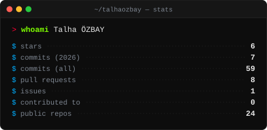
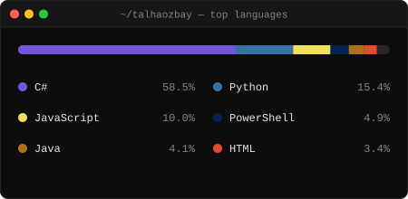
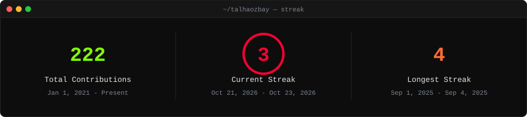
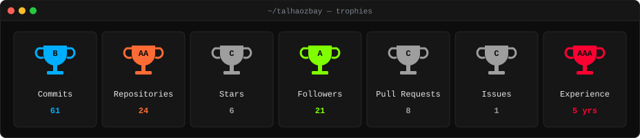
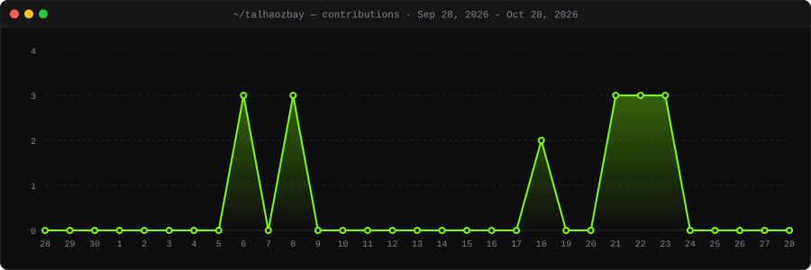

# `> Talha` - also known as **talhaozbay**

**Full-Stack Dev · Security Tinkerer · Open Source Mercenary**
*Writing code, breaking things, and occasionally fixing them.*

> *"Try not to be perfect"* - self-injected XSS wisdom

---

<!-- ## ⚡ ARSENAL

 -->

---

## 📊 THE NUMBERS

 

---

## 🏆 ACHIEVEMENTS

---

## 📈 CONTRIBUTION ACTIVITY

---

<!-- 

**`> You've been profiled. No bugs were harmed... much.`**

 -->